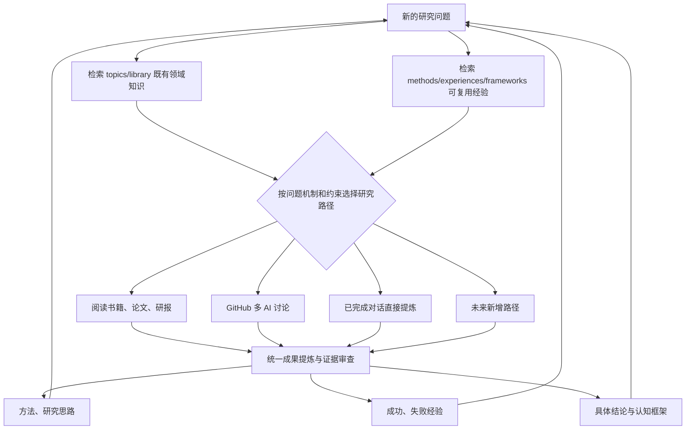

# FRAMEWORK-001 · 问题驱动研究、多路径产出与成果复用

- **来源**：2026-11-01 用户本次关于 AI_book 定位、双路径和未来多路径扩展的真实需求。
- **状态**：DESIGNED / NOT_VALIDATED_IN_KAIPING
- **关联方法**：[METHOD-001](../methods/METHOD-001-question-chain-distillation.md)
- **关联案例**：[开平煤矿研究入口](../docs/intake/kaiping-coal-mine.md)

## 不能改变的 AI_book 定位
**从研究问题出发，阅读书籍、论文和研报，通过讨论、反证和研究不断形成理解。** `methods/`、`experiences/` 与 `frameworks/` 是可复用成果库，而不是替代 `topics/` 和 `library/` 的主系统。

## 多路径研究层
- **原有阅读研究**：问题 → 文献检索 → 章节/原文阅读 → 论点与反证 → 问题理解。
- **GitHub 多 AI 路径**：问题 → Discussion/Issue → 不同 AI 提议与挑战 → 证据与方法审查 → PR 合并。
- **已完成研究提炼路径**：已结束对话 → 提问演化及方法操作还原 → 经验与结论抽取 → 成果归档；**不需要重新研究同一问题**。
- **未来路径**：实证实验、量化回测等仅是可扩展接口，非本次已实现功能。

## 统一沉淀：三类资产
1. **研究方法与思路 Method**：可复用的问题处理过程、输入、步骤和边界。
2. **研究经验 Experience**：实际做过什么，成功、失败、限制与验证。
3. **研究结论与框架 Conclusion/Framework**：专题结论归 `topics/`，跨专题的概念/行业/思维框架归 `frameworks/`。

允许一次研究只产出其中一类；无效讨论不需要人为制造方法卡。AI 赞同和 GitHub CI 通过均不等同于研究结论已证实。

## 统一闭环

## 图谱关系与溯源
- `question_evolves_into`：问题因何追问、转向或分叉，必须来自可定位的原始研究过程。
- `derived_method`：方法源自哪些真实推理步骤。
- `method_applied_in`：方法在何次研究中实践，结果如何。
- `framework_composes`：框架引用哪些方法、核心概念与局限。
- `claim_supported_by`：具体结论来自哪些书、研报、证据与反例。
- `reused_in`：某方法用于哪个新问题、满足何种约束及检验结论。

## 下一轮研究前的执行规则
先提取新问题的目标、机制、数据/资料条件，**同时**检索问题知识和研究方法；匹配适用条件后决定复用还是新探索。研究结束后，差异化更新方法、经验、框架与专题结论，重复方法优先合并修订，不新增空泛卡片。

## 关键边界
本文件描述规范，**不能代替对开平煤矿旧会话的逐句分析**。旧会话无法读取时，保留来源不足状态，不臆造历史讨论路径和成功经验。
