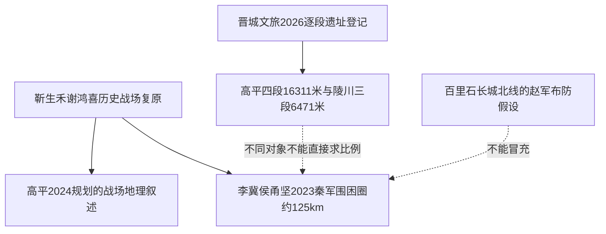

# TOPIC-013 第六轮｜现存战国长城7段长度、端点与军方归属审计（2026-11-15）

> 独立于本专题此前的4段16km粗数，2026-10-22《太行日报》刊载晋城文旅整理的7段逐段长度与起止地名；**这些是遗址登记长度，不等于秦军围圈长度，也没有给出每个端点经纬坐标**。

## 一、七段实录

|编号|遗址|县市|公开长度|GIS证据状态|
|---|---|---|---:|---|
|GP01|苟家村长城|高平市|3,480 m|只有山脊/村庄起止地名，未取得坐标|
|GP02|关家村长城|高平市|3,635 m|只有山脊/村庄起止地名，未取得坐标|
|GP03|东沙院村长城|高平市|4,702 m|只有山脊/村庄起止地名，未取得坐标|
|GP04|后山村长城|高平市|4,494 m|只有山脊/村庄起止地名，未取得坐标|
|LC01|闫家沟村长城|陵川县|1,380 m|只有山脊/村庄起止地名，未取得坐标|
|LC02|北山村长城|陵川县|2,166 m|只有山脊/村庄起止地名，未取得坐标|
|LC03|泉头村长城|陵川县|2,925 m|只有山脊/村庄起止地名，未取得坐标|

- 高平四段精确合计 **16,311米**，高平市政府2025-12官方称“四段累计约16公里”，两者量级相合。
- 陵川三段精确合计 **6,471米**；七段合计 **22,782米**，与2026晋城文旅报道一致。
- 地名描述可构成 **13,586米的“五段候选走廊”**：闫家沟→北山→泉头→苟家→关家；**不是**已验连续无缺口的考古线段。北山附近、泉头附近两接点的方位/距村距离存在差异。
- 泉头末端↔苟家起点在宝龙寺山顶附近描述高度吻合；苟家末端↔关家起点在曹家沟北1.5km描述重合，对应**3段登记合长10,040米的强连接候选**，但无经纬仍不称坐标精确相接。
- 东沙院与后山两段另有各自山脊地名，现有表未说明它们与上述候选走廊相接，不得为了凑闭环伪连。

可复用机器资料：[遗址7段CSV](../models/changping-seven-wall-segments-20261022.csv)、[端点关联/不确定性CSV](../models/changping-wall-endpoint-joins.csv)。引述[太行日报·晋城文旅2026-10-22](https://finance.sina.com.cn/wm/2026-10-22/doc-iniwavxm5980446.shtml)、[高平市文旅局2025-12-03](https://www.sxgp.gov.cn/zjgp/fjms_425/202512/t20251210_2295436.shtml)。此为同一城市文旅资料链的前后精化，**不是两次互相独立的考古发掘**。

## 二、最关键的军事对象分离：赵国北线 vs 秦军围圈

[高平2024—2040长平遗址保护规划（2024年12月）](https://xxgk.jcgov.gov.cn/jcsrmzf/zc/jszb/202502/P020250218395708726584.pdf)把战役早期空仓岭西线、丹河东线、**百里石长城北线**表述为**赵军三道防线**，并单独描述秦军的进攻；[杨名宇2020《步兵季刊》长平之战研究](https://www.mnd.gov.tw/File/33375)亦把百里石长城描述为赵第三道防线，但后者大量沿用此前战史/靳谢复原，**不是完全独立的战国考古证据**。

《山西晚报》2026-04-24[《论百里石长城》](https://www.sxwbs.com/detail/4f604083480b4070bc8937dbaa2167f4?contentType=1&t=MjAyNi0wNC0yNA%3D%3D)转述明万历《潞安府志》古长城、1960年代长城调查提出“百里石长城约120公里”，并讨论筑造者/始建年代分歧。**这个120公里是沿山脊东西延伸的长城系统，不是论文从另一张图测算的秦军最终包围圈125公里**；仅数字接近不足以认定同一几何线。1960年代原始调查报告和明代府志仍待原件校勘；2026文章本身属于现代论述，不能代替原档。

高平2025官网概述认为长城形成与战争后期有关，2026地方史论文章则提出边境线更早形成可能，**遗址具体修建年、城墙单段归属、是赵还是秦在最后46天使用，都不能由这些报道给出统一确定答案**。

## 三、来源依赖与模型后果

先要取得“秦军最后围圈”的**独立**路线测点和同时段守线证据，再考虑五人纵深。如果确为赵军早期防线，不能无证拿现存7段反向认定秦军最后围圈全部125km拥有五行步卒。

## 四、未解决的资料

2026报道只给地名相对方位与米数，缺WGS84坐标、地质剖面、墙体修筑断代、秦赵方别及最终46天驻守方式。**本轮不输出人工补造经纬点，也不把136?公里的宽地理叙述变成闭合GIS路线**。GIS需要地理配准而非想象。
