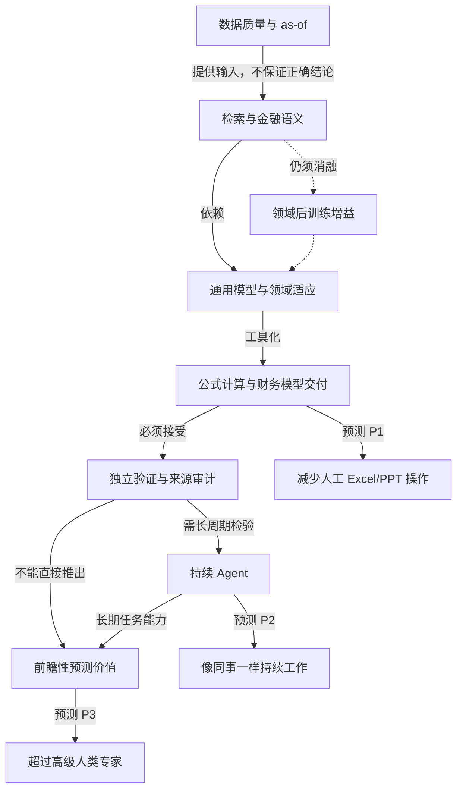

# TOPIC-006 · 金融 AI 能力链与三项预测

> 这是**研究框架图**，箭头代表研究假说或必要工作联系，不代表已证实的因果链。

- 数据可信与模型正确并非同义。
- 输出工作簿与工作簿满足专业可维护标准并非同义。
- 历史问答准确与事前投资预测表现并非同义。
- P1/P2/P3 属于演讲预测，尚不是定论。

对应论点 [claims.md](claims.md) 与 [研究问题](questions.md)。
