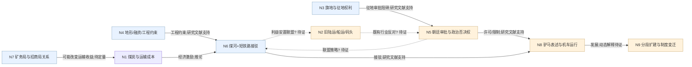

# TOPIC-004｜利益与制度机制知识图谱（研究假说版）

该图只表达**分析对象与待检验的关系**，不是全体箭头已由史料证明的因果图。

## 关系解读

- **实线**：文献所支持的事件关联或一般经济作用，仍要看标注是否有推论。
- **虚线**：明确的待验证政治机制。
- 「旧运输业」「旗地持有人」「矿务局与招商局」**不能合并成二元阵营**；交通运输不同路段可能互补或替代。
- 图谱不是支付函数估算，更不证明李鸿章或唐廷枢的主观规划。

[机器可读 JSON](knowledge-graph.json) · [论点台账](claims.md) · [方法论](../../docs/methodology/infrastructure-reform-coalition-process-tracing.md)。
