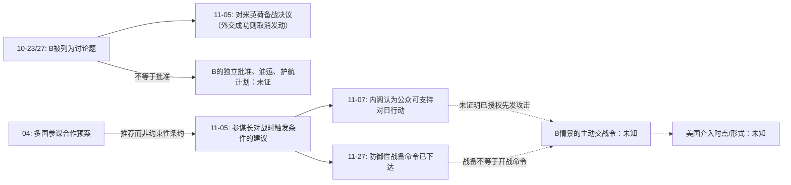

# DEBATE-001｜R6新增关键证据：1941美国交战授权链 × 日本战争决策链

**R6-DESK-AUDIT-20261104-B｜同一AI编辑复核，不是独立历史同行审核**  
**AS_OF=1941-11-30**；**STATUS=SOURCE_CANDIDATES / NOT_INTEGRATED**  
上游[R4-FINAL](https://github.com/fweiger/AI_book/issues/18#issuecomment-6631875211)；本轮PR：[PR #19](https://github.com/fweiger/AI_book/pull/19)

## 新发现的核心问题

原辩论把以下命题很容易混作一个断言：
1. 美国**有意愿**对日本攻击英荷殖民地予以军事回应；
2. 美国**与英荷形成已批准的自动参战义务**；
3. 美国**已向舰队下达有效战备命令**；
4. 美国**已授权在未遭日本直接攻击时，首先攻击仅在英荷领土作战的日军**。

**查证结果是：1的政治意愿得到同期内阁记录支持、2在战后国会综合审查中被明确否定、3确有实际发布的战备与防御命令、4仍未取得相应的特定交战授权。**“未取得”不是证明任何形式的4绝对不存在；不能据此赋值介入概率。

同理，日方不能把**讨论只攻荷兰/英荷B**与**批准B的军队/资源/护航执行方案**视为等价。

## A. 日本决策链：不攻击美国只是被讨论过的方案，11月5日不是被批准的国家战争方案

| 时间（均1941） | 同期文件与当前载体 | 能确定的最低限度事实 | 未能推出 |
|---|---|---|---|
| **10-23** | [JACAR第59回连络会议官方资料说明](https://www.jacar.go.jp/exhibition/nichibei/popup/19411023a.html)，引《杉山メモ》图80左—82，印刷p.363，**官方说明含转录** | 第八题：是否可把战争对象限定在**荷兰或英荷**；同时评估年度船舶徴佣/损耗、国民经济、推迟开战与继续交涉。此处是**问题清单** | B被通过、存在完整B方案 |
| **10-27** | [JACAR第62回连络会议](https://www.jacar.go.jp/exhibition/nichibei/popup/19411027a.html)，官方说明、图87左—93右 | 正式讨论“美英荷可否分离”；官方说明**仅说外务与海军解释**，没有记载有限战争获批。并讨论供需及造船：1942年度物资供给力被认为约为1941年度九成、库存将消耗，官署担忧造船力减半 | 某具体派系赞成B、B已否决的逐字会议结论 |
| **11-01/02** | [JACAR编目 C12120239300](https://www.jacar.archives.go.jp/das/meta-en/C12120239300)（搜索索引可读，直接页面403）；[东京大学/政策研究大学院大学“世界と日本”所引11-02连络会议决议](https://worldjpn.net/documents/texts/pw/19411102.O1J.html)（后出官方资料转录） | 议程由方案评估转为**对美国、英国、荷兰战争准备的正式决意草案**；具体会议日期在JACAR不同件编目与外交文书转录有11-01/02标记差异，应依各案卷形成日期区分 | 11-01与11-02绝对是同一原文形成时间；不能忽略不同底本 |
| **11-05** | [JACAR官方专题Document17，档号C12120186900图15—16](https://www.jacar.go.jp/english/exhibition/showa100/01_02.html)；[JACAR编目C12120186200及其检索正文](https://www.jacar.archives.go.jp/das/meta/C12120186200)；[11-02起草文本](https://worldjpn.net/documents/texts/pw/19411102.O1J.html) | **御前会议决议准备对米英荷战争**，军事发动时间为12月上旬；同时规定**若对美谈判于12月1日00:00前成功则停止武力发动**。因此11-30信息集仍包含**外交中止发动**的正式条件 | 不等于1941-11-05已经正式对美宣战，也不单凭国策决议证明夏威夷奇袭的独立作战批准细节；**更不能说B在11-05仍是获批准待执行的等价替代案** |
| **12-01（超过AS_OF，仅事后核证）** | [《对米英荷开战之件》，世界と日本转录外务省资料](https://worldjpn.net/documents/texts/pw/19411201.O1J.html) | **新的御前会议**依据11-05决议确认谈判未成功、作出开战决定；只用于证明11-05“准备/有条件”的层次不同于12-01决议 | **禁止**把12-01已发生事实用作11-30决策者已经观察到的信息 |

**限定结论：**1941年10月的B属于**当时正式会议提出的反事实选项**；但**截至11月5日，已批准的国策是对米英荷战争准备、附带外交达成即取消发动的条件**，未见B独立获批。是否“可在11月30日重新选择B”是可执行性反事实，不是事实状态。

## B. 美国决策链：政治意愿、战争义务、军方命令分别核查

| 时间（均1941） | 载体与直接阅读/原文层级 | 可以成立的事实 | 不能直接成立 |
|---|---|---|---|
| **4月新加坡参谋会议** | [美国国会珍珠港联合调查 Part IV，印刷pp.170—172](https://www.ibiblio.org/pha/pha/congress/part_4.html)（**1946调查结论与听证引用**，不是1941新加坡原件）；Marshall证词同报告p.176 note89 | 参谋制定合作预案；Marshall明确说他们只是同意**向政府推荐**、无代表美国政府签订战争义务权力；Turner称ADB文件还未正式交总统/军政首长批准 | “参谋合作=英国荷印遭袭美国无条件自动参战” |
| **11-05** | [Exhibit16印刷pp.1061—1062](https://ibiblio.org/pha/congress/Joint%20Committee%20Exhibits/Exhibit%20016.pdf)，**国会复制的1941同日原文影印两页均已查看** | Marshall与Stark建议避免过早战争；日本直接攻击美国/英联邦/荷印领地或指定地区扩张时，军事回应**可以被认为有必要** | 总统/国会已采纳为自动参战命令、亚洲舰队已获对B先发开火权 |
| **11-07** | [Stimson 1941-11-07日记经1946年公开摘录](https://content.time.com/time/subscriber/article/0,33009,792673,00.html)；[国会联合调查印刷p.171](https://www.ibiblio.org/pha/pha/congress/part_4.html)；[美陆军战史 ChapterVI](https://webdoc.sub.gwdg.de/ebook/p/2005/CMH_2/www.army.mil/cmh-pg/books/wwii/framework/ch06.htm) | 罗斯福对**公众是否支持在日本攻击英马来亚/荷印后反击**非正式征询内阁；内阁一致认为公众会支持。**这是重要的政治介入意愿证据** | 不等于内阁批准开战、公众真实民调结果、总统直接命令舰队攻击 |
| **11-27（备忘录）** | [Exhibit17印刷p.1083](https://ibiblio.org/pha/congress/Joint%20Committee%20Exhibits/Exhibit%20017.pdf)，**1941原文的国会影印直接查看** | 参谋长要求避免抢先军事行动、争取增援菲律宾；写出日本攻击/直接威胁美英荷领土等条件，建议先警告再采取跨越泰国界线的行动；**同一文书建议尽快完成英荷合作协议** | 11-27时已将所有合作安排完整签核，或已宣布只要英荷遭袭立即打日本 |
| **11-27（发给舰队的电报）** | [美国国家档案馆Greg Bradsher档案说明，引用Stark原电及Marshall发给MacArthur原电](https://text-message.blogs.archives.gov/2018/12/06/prologue-to-pearl-harbor-the-spy-flight-that-wasnt-part-ii/)；来源为**官方档案研究逐字引用**，原电纸质母件另行核验 | **真实执行层已启动：**Stark给亚洲舰队Hart和太平洋舰队Kimmel下达`war warning`并要求防御部署；Marshall指示驻菲律宾部队适当侦察和准备，若不得不开战应使日本首先作公开敌对行动 | “完全没有任何执行命令”属错误；同样“战备电令=针对仅打英荷的日军开始全面攻击命令”也错误 |
| **11-30** | [1946国会联合调查p.172—173引1941-11-30东京给柏林的被截电报](https://www.ibiblio.org/pha/pha/congress/part_4.html)，**1941外交原文的调查摘录** | 一份日本官方对外电报把美国判断为正与英国/荷兰等配合对付日本，**提供至少一个1941年11月30日存在的日本方面主观威胁认知样本** | 单份电报不能证明日本高层一致相信美必立刻参战，不能证明美国客观上已有自动开火承诺 |
| **1946战后核证（不可回填1941信息集）** | [国会联合调查pp.170—172](https://www.ibiblio.org/pha/pha/congress/part_4.html)，报告和证词 | 国会联合调查明确认为**不存在**使美方在英荷遭袭即自动参战的有约束协定；Marshall的原证词明示参谋会谈无政府授权。该结论可用于**今天的史实审计** | “战后调查的知识”不属于日方1941已知；“没有自动盟约”也不等于美国不会作出新的参战决策 |

### 重要：11月27日确有战备执行命令——需要纠正一个潜在表述错误

此前R6将美国链路写为`建议→政治批准→ROE→执行`，容易被误读成**所有执行环节都完全空白**。现已找到与这一说法相冲突的1941年11月27日`war warning`及`defensive deployment`命令。因此应拆分：

- **已知执行**：防御部署、侦察、战争预警命令（确已下达）；
- **未证执行**：当日本**仅攻击英荷**、并未攻击美国或直接威胁美国部队时，授权美军立即对日实施进攻或封锁的特定命令；
- **可能动态转移**：总统/国会政治决策可能快速变化，美海军亦可能发生有限武装接触，不能先验设置一定0或一定1。

## C. 因果图（候选，不修改正式knowledge-graph.json）

## D. 对C-ID的建议改动（正式claims.md不在本PR修改）

| C-ID | 新证据带来的变化 | 推荐证据状态 |
|---|---|---|
| **C002** | 10-23/27官方会议确认B进入考虑范围；11-05国策已转为**对美英荷战争**，且外交谈成可停止军事行动。B不是11-05已批准方案；不能把“有B讨论”夸大成“B当时可独立执行” | 纠正二元“只有一种战争路径”的绝对命题，但B可行性**仍待证** |
| **C009** | 11-27美方真正下达的是**防御部署/侦察**战备警报，而非经证明的“远东自由航行区自动封锁” | UNSUPPORTED_AS_FACT；注明确有战备命令但封锁授权未证 |
| **C010** | 11-05日本国策有**12月1日前外交成功即可停止武力发动**的明确条件；历史决定有条件性，不能由最终开战倒推必然性 | UNDETERMINED，增加正式条件性决议反例 |
| **C012** | 1941-11-07内阁公众支持判断及11-27战备指令**提高政治介入意愿证据强度**；1946国会调查及Marshall证词**否认自动参战承诺**；把“无战争命令”修正为“无经证实的B场景下抢先作战授权” | **PARTIAL_FACT / COMMITMENT_NOT_PROVED** |
| **C017** | 11-05已确定战争准备对象为美英荷，并存在暂停发动条件；12-01另作决战决定。**两级决定不可混淆** | 战争政策文件存在为同期史实，具体终战成败另审 |

## E. 仍然不能宣布“B优于A2”或“B必导致美国参战”

1. 即便美国11-07内阁判断支持军事回应，依旧缺1941-11-30前**总统在明确B情景下将采取哪一条执行路径**的具体批准文件；反过来说，正式政治授权也可以在B实行后迅速出现。
2. 即便11-05日方已批准对三国作战争准备，**没有证明**只攻英荷的油井/专用油轮DWT/港口修复/军事护航等整套计划已经存在并且可以即时替代。
3. 11月30日一份日本发柏林电报说明日方**有人怀疑美英荷协同**，并不能转化成日方统一的参战概率或战争最优性证据。
4. 11-27美军防御命令在真实世界已执行；反事实B没有发生，不能从既定防御部署推出假想B后美军一定开火/不开火。
5. 后出美国1946调查及日本1941-12-01决议均只用于**今天审查**，绝不混入1941-11-30已知事件集。

## F. 复核与下一步证据门槛

- 美国：检索1941-11-27前后给**Hart/Kimmel/MacArthur**的战区ROE、封锁、护航与开火指令，必须精确列出授权机关、适用条件、发出及生效时间；并检查**假设仅攻击荷印**是否实际符合该条件。
- 日本：追索10-23/27《杉山メモ》手稿逐字校勘、11-05御前会议决议原图、1941海军军令和一切B专门船油预算。JACAR原件页在当前网页访问有403时，不应声称已打开原始扫描。
- 史料级别：1941形成且1946影印公开的**原文**、1941年同期日记的**后出摘录**、1946年国会调查者的**推论**、1952年日海军当事人的**战后回忆**全部另列，避免相互冒充。
- **本轮复核非第二位独立审稿人批准；PR保持DRAFT，知识状态NOT_INTEGRATED。**