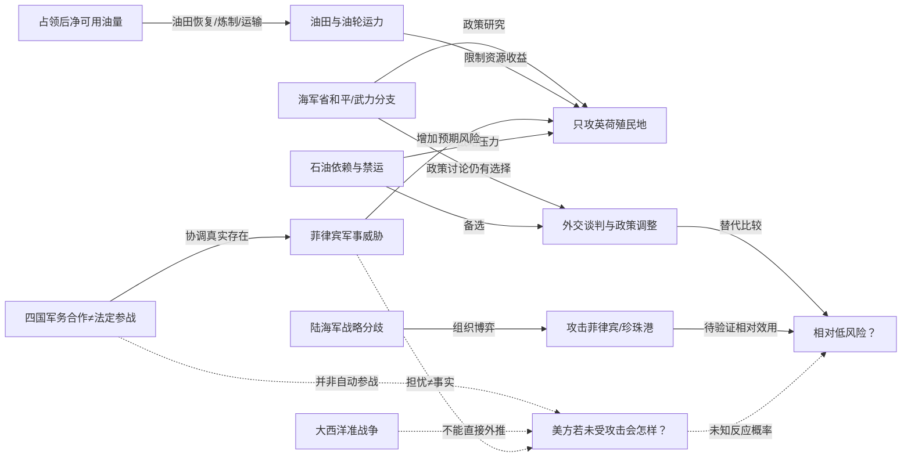

# TOPIC-004 · 关键决策逻辑与反证图谱

**以下连线是研究假说或历史关系，不是数学因果证明。**

## 三种不同层面的“箭头”

- **实线**：资料表明历史上确有约束或机构间分歧；仍需进一步标注出处。
- **虚线**：作者或模型提出的解释桥梁，未获证实。
- **最重要的反事实**：美国即使未经珍珠港攻击，是否会主动切断日本海运？这需要独立的美方政策、法律与军事资料，不能从日本当时对美军的担忧中直接推得。

[JSON图谱](knowledge-graph.json) · [论点台账](claims.md) · [史料](sources.md) · [Issue讨论](https://github.com/fweiger/AI_book/issues/16)

2026-11-04新增档案的详细来源：[日本海军省原文](primary-source-close-reading.md) · [油运数据](oil-logistics-evidence.md) · [四国协调](allied-response-matrix.md)。
