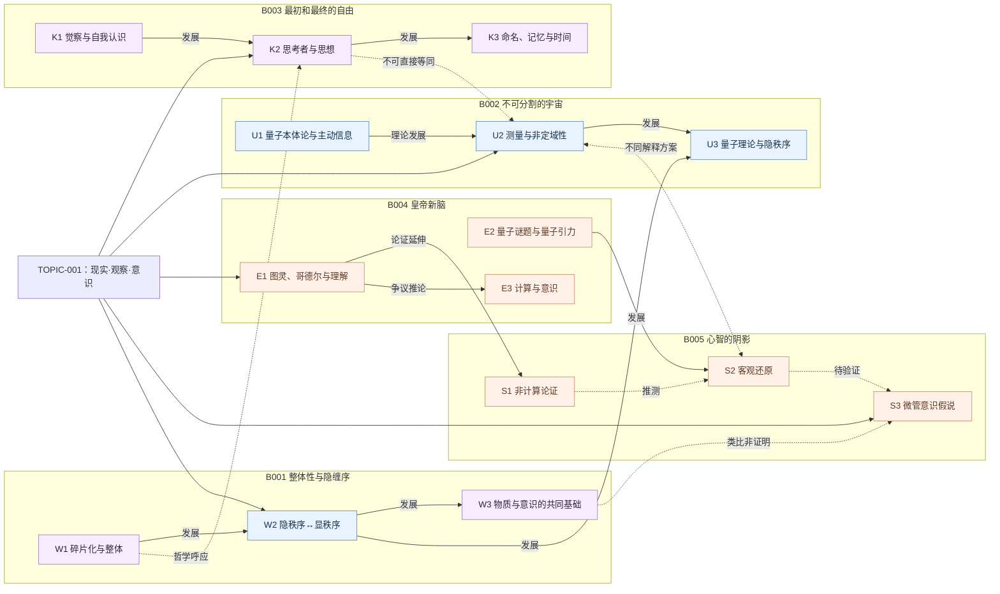

# 专题知识图谱 v1 · 总图

这是**问题驱动**的知识图谱，不是五本书目录的简单合并。节点为核心概念/争点，关系区分概念延伸、解释对照、类比与风险警戒。以下章节仍为**目录级**，没有宣称已逐页验证。

## 图谱怎样读

- **实线“发展”**：理论或作者论证的推进，**不保证所有步骤获证**。
- **虚线“对照/类比”**：两本书讨论相似问题，但证据不能跨领域直接转移。
- **虚线“推测/待验证”**：值得继续跟踪，但不应说成已经证实。
- **“不可直接等同”**：提醒同名术语有不同语境，例如心理观察者与物理测量器。

## 关键跨书阅读入口

| 主线 | 节点 | 首要章节 | 研究问题 |
|---|---|---|---|
| 整体与碎片 | W1 → W2 → U3 | B001 第1–3、6章；B002 第15章 | 隐秩序如何变成一个可区分的物理主张？ |
| 测量与意识 | U2 ↔ S2 | B002 第5–7章；B005 第5–6章 | 测量问题一定需要意识吗？ |
| 观察与自我 | K1 → K2 ↔ W1 | B003“思考者与思想”；B001 第1–3章 | 两种“观察者”差别在哪？ |
| 计算与理解 | E1 → S1 | B004 第2/4章；B005 第1–3章 | 哥德尔数学定理与反计算主义之间缺哪些假设？ |
| 意识机制 | S1 → S2 → S3 | B005 第5–8章 | 微管如何产生可验证预测？ |

相关链接：[机器可读节点/边](knowledge-graph.json) · [研究问题](questions.md) · [证据状态](claims.md) · [阅读路线](reading-path.md)。
