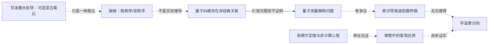

# 视频推理链初审 · 2026-10-27

视频主题：玻姆隐秩序、量子纠缠、意识与彭罗斯非计算思想。此文件是用户提供转写的**原创研究提要**，不复制受版权保护的完整视频文稿。

## 核心链条与断点

## 原视频叙事中哪些值得保留？

1. 甘油实验具有解释“不可见结构如何仍可存在”的启发性，但不证明隐秩序存在。
2. 玻姆确实提出了量子本体论的另一种严肃理论，而不是“现代物理已证实宇宙意识”。
3. 量子纠缠说明非经典关联，不等于相隔万里瞬间发消息。
4. 量子测量难题不是“意识导致坍缩”的实验结论。
5. 彭罗斯对“心智等于算法”的批评值得读原著，但他对哥德尔定理的哲学推论并不等于数学证明。
6. 微管是神经细胞中的结构；Orch OR 是否解释意识仍需独立实验检验。
7. “观察者是被观察者”在克里希那穆提那里首先是心理与认识论主张，不能偷换为物理测量。
8. 历史故事、奥本海默引语的具体场景、玻姆临终言论仍须一级史料核对。

## 面向五本书的下一步

- 先读 B001 第6章，审查隐秩序概念是物理模型还是解释性框架。
- 再读 B002 第6章，检查为什么不需要“意识让结果确定”。
- 读 B004 第4章与 B005 第2–3章，画出哥德尔论证的全部额外假设。

关联：[论点台账](claims.md) / [章节路线](reading-path.md) / [问题清单](questions.md)。
