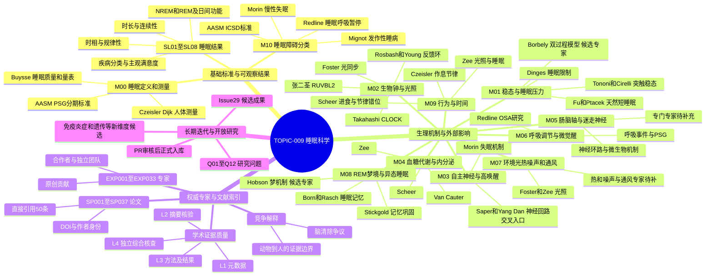
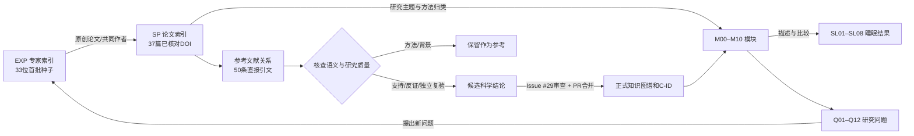

# TOPIC-009｜睡眠科学 M00–M10 × 权威专家知识库思维导图

> 基于 TOPIC-009 v0.2.0 的可维护研究地图。研究方向对应不等于医学因果成立；图上姓名仅是每个分支的代表性专家入口（完整 33 人请读 [注册表](experts/experts.json)）。M00/M10 是定义与分类，不是生理机制；SL 是结果/表型；EXP/SP 是索引，不是 M11。

## 1. 全局思维导图（M00–M10 全覆盖）

## 2. 论文与专家怎样和 M00–M10 相连

该图特意将“机械化引用关系”和“经过实际原文核验的支持/反证”分开。**被引用并不等于被独立复现**，专家权威不自动证明任一医学因果结论。

## 3. 代表性专家与模块交叉索引

| 权威专家与论文路线 | 首要模块 | 其他涉及模块 | 需要核验的关键科学问题 |
|---|---|---|---|
| 张二荃：RUVBL2、节律及睡眠剥夺研究 | M02 | M01、跨域免疫/炎症 | 分子节律与睡眠稳态、免疫后果是否具有直接因果桥梁？ |
| 傅嫈惠 / Ptáček：DEC2、ADRB1、NPSR1 | M01 | M02、M10 | 天然短睡眠与早睡早起如何区分；是否有独立验证？ |
| Borbély（候选）：双过程模型 | M01 | M02 | Process S 与 Process C 如何分别量化？ |
| Mignot / Yanagisawa / de Lecea：Orexin 系统 | M10、M01 | M03 | 从分子发现到疾病与脑回路干预的证据链 |
| Tononi / Cirelli 与 Nedergaard / Franks | M01 | M08、潜在新机制 | 突触稳态、脑清除的测量和竞争解释 |
| Buysse / Czeisler / Dijk / Dinges | M00、M01 | M02 | 各类测量方法与实验控制能否分离睡眠稳态与生物钟？ |
| Van Cauter / Scheer / Zee | M04 | M02、M07、M09 | 代谢、光照、节律错位与睡眠结果的因果方向 |
| Redline / Morin | M06、M10 | M03 | 呼吸障碍和失眠的临床分类、共病与测量边界 |

## 4. 迭代规则

1. 保持 M00–M10、SL01–SL08、Q01–Q12 的稳定编号；新增领域先作为候选问题，不自动命名 M11。
2. 新增专家先验证身份（ORCID/机构）、至少一项原创贡献；新论文按 DOI 去重，并判断是否与既有 AIH-S / X 来源卡重合。
3. 每条新证据要留下实验对象、研究类型、真实阅读层级、独立复验及相反解释。
4. 先更新 [专家库](experts/README.md)、[权威映射](experts/MODULE_CROSSWALK.md)、[研究方法协议](experts/RESEARCH_PROTOCOL.md)，在 [Issue #29](https://github.com/fweiger/AI_book/issues/29) 提交可核查内容，经 PR 审核合并后才提升 C-ID 状态。
5. 随知识结构更新修订本图；本图是研究导航而不是治疗指南或已完成的全球专家排名。

[原始 M00–M10 总纲](FRAMEWORK.md) · [SL01–SL08 结果](OUTCOMES.md) · [既有知识地图](knowledge-map.md) · [33 位专家](experts/experts.json) · [37 篇论文](experts/papers.json)
