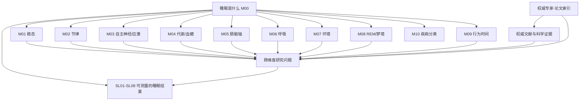

# TOPIC-009 · 睡眠科学开放研究知识地图

**箭头表示研究路径与概念归类，不表示每条通路已经在人体中实验证实。**

[完整思维导图](MINDMAP.md) · [专家研究索引](experts/README.md) · [核心框架](FRAMEWORK.md) · [权威矩阵](AUTHORITY_MATRIX.md) · [跨维度映射](CROSS_DIMENSION.md) · [问题列表](questions.md) · [机器图谱](knowledge-graph.json)。

## 新增跨疾病研究路径

[PATH-ASCVD-01：睡眠—神经免疫—动脉粥样硬化/卒中预防](pathways/sleep-immune-atherosclerosis/README.md) 连接 M00/M01/M02/M03/M04/M06/M09 与 Q13，作为**研究分类与可检验问题路径**；不表示完整人体医学因果关系已获证实。
