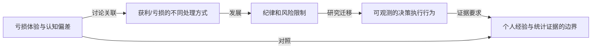

# TOPIC-003 · 初始知识图谱

> 当前只是**书目级概念导航**，不代表已经按章核验了原文。要继续研究请从 [问题索引](questions.md) 开始。

- [结构化 JSON](knowledge-graph.json)
- [精读路线](reading-path.md)
- [证据台账](claims.md)

关系标签表示研究流程中的**预备关联**，不是已经得到原书证明的因果关系。