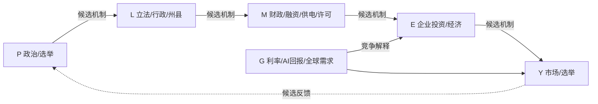

# TOPIC-011｜因果结构和长期研究框架 v0.1

## 研究区间的四次时钟
- **2026-11-02**：选举前可公开获得资料的冻结截止时间，后发经济数据不可倒填。
- **2026-11-03/04**：选举/媒体判断多数控制权；**2027-01-03**：新一届国会正式开会。
- **2027—2028**：法案、财政执行、州县AI许可、企业财报和2028大选。
- **2029-01-20**：本届总统任期结束，完成最后预测回顾。

## 分层传导
1. P：党派多数/委员会/2028选民激励；非直接经济量。
2. L：法案**提交→通过→总统签署或否决→实际执行**，行政命令、联邦与州县监管；各状态必须分开。
3. M：实际非利息财政支出与周期调整初级余额、风险溢价/借贷成本、数据中心电价/并网/许可时间。
4. E：公共支出/税收、AI CAPEX指引与**真实**投资、建设投产、云需求、GDP和就业。
5. Y：企业盈利预期、行业超额回报、期限溢价/信用利差、政治反馈与2028选举。Y→P/L可能形成反向影响。

## 可操作假说链
- **K01 国会→财政→市场**：H01→H02→H07。
- **K02 国会→AI政策→CAPEX→市场**：H01→H03→H04→H07。
- **K03 国内受阻→外交/2028选举**：H01→H05→H06；需区分国际外生冲击。
- **K04 非政治AI周期**：H08→H04→H07；是K02的最强竞争假设。
- **K05 反馈**：H06→H01及H07→H06均是**候选**反馈，不能预设因果。
- **K06 财政/AI分化**：H02政策性支出增加与H03监管增强可以同真，财政和AI不必同向。

### 原视频的可检验版本
“新国会控制权变化→政策对抗上升→财政扩张减速与AI项目成本增高→资本支出指引下修→市场/增长再定价。”这是**路径P-B**，但与对抗且AI继续增长、财政重配、AI自身周期减速等路径竞争。必须逐边核验，不能因为投资下降就倒推民主党为原因。

### 三种不同的投资放缓
1. 投资美元绝对额下降；
2. 投资仍增长，但同比增长率降低；
3. 事前市场/公司**投资预期下修**，实际投资不一定已经降低。
未来报告必须分开披露。

## 证伪设计
- 先在2026-11-02冻结CBO/公司/项目已公布的基线；随后以**原始发布日期**做增量更新。
- 制度：2027新国会实际法案/拨款/否决/调查，与2025-26历史比较。
- 财政：结构性初级余额、非利息支出及与旧基线偏差；防止将利息或经济周期当成积极财政政策。
- AI：联邦/州/县政策暴露差异、同企业美国/海外项目对照、工期/投产、SEC/IR资本开支，检验并行趋势。
- 市场：事件时点盘中/盘后、1/5/20交易日窗、事前预注册市场与利率控制、安慰剂事件窗、零结果。
- 允许**同一季度多个路径同时支持**，并允许从P-A游走到P-B或P-C；历史快照不覆盖，证据反转可撤销判断。
