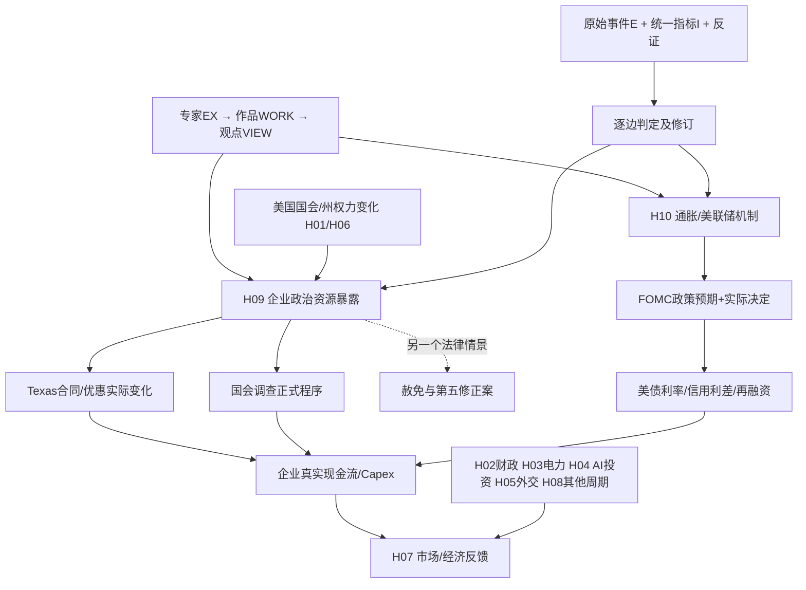

# TOPIC-011｜因果链层（Chain Layer）

所有链的箭头都仅表示**需要单独验证的候选机制**，不是已证明因果。可单独沿着每个节点做研究，允许只支持前两步、后续边不成立、反向作用与路径迁移。每条链必须有 `chain_id`，不要与旧 [data/causal_edges.csv](../data/causal_edges.csv) 中 **K01–K10已被占用的边ID** 混用。

## 跨模块研究链图

## 文件
- [链定义表](chain_registry.csv)：7条子链含两条既有宏观路径，关联H01-H10和具体VIEW。
- [逐边待检验表](chain_edges.csv)：每条箭头的可观察指标、竞争性解释、初始状态均UNTESTED。
- [统一指标库](../metrics/README.md)：所有链只引用已有I ID，严禁复制不同口径指标。
- [马斯克案例](../cases/musk-2026/README.md)：州政策、国会监督和赦免法律程序三轨不可相互代替。
- [主假说H09/H10](../HYPOTHESES.md)；政治市场长期线保持 [P-A—P-D](../PATHWAYS.md) 原有竞争路径共存。

## 核验顺序
1. **证据节点**：是否真正有正式州政策/特定合同、国会传票、赦免文件或CPI/FOMC决议？观察时点和主体明确。
2. **机制边**：政策是否改变企业实际现金流？通胀发布是否带来超预期的利率路径变化？如果没有则截断此边，即使后续股价有变化也不能倒推。
3. **结果节点**：公司SEC财报、债务到期表、现金流、股价/信用利差是否发生预注册窗内的**额外**变化。
4. **反事实**：州界内外同业对照、公告前共同趋势、2025—26旧法前置、政策/利率同时冲击、可比企业的融资锁定期限。缺口标NA，**不能用评论者主张覆盖空白**。
5. **证伪**：建立逐月/季度快照状态`UNKNOWN/SUPPORTED/CHALLENGED/MIXED/SUPERSEDED`，对事件确有发生与整条链证实分别判定；未来预测另外进forecast_registry，不反向编辑旧预测。

## KID冲突修复
2026-11-14早期VIEW-S001叙述曾把三条候选线暂称“K07/K08/K09”，但是原始因果数据表K07、K08、K09已分别属于H05→H06、H08→H04、H08→H07，**不能重用**。本层采用独立的 `CHAIN-MUSK-TX-01`、`CHAIN-MUSK-CONG-01`、`CHAIN-MUSK-PARDON-01`、`CHAIN-FED-01`、`CHAIN-MUSK-INTERACT-01` 及 `CHAIN-LEGACY-*`，且原有K01–K10保持不变。旧视频观点只是历史来源描述，不代表稳定数据库ID。

