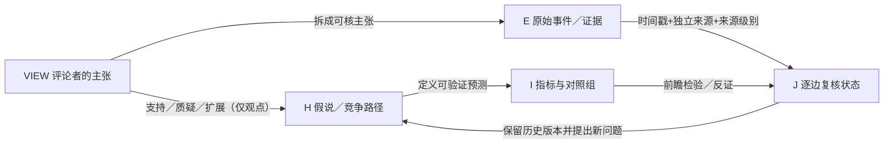

# TOPIC-011｜专家／UP主观点来源池（VIEW）

> 研究对象：2026-11-03—2029-01-20 美国政治—财政—企业—金融市场的候选机制。**VIEW 是评论者的陈述，不等于经独立验证的事实、因果效应或预测命中。** 本文件属于尚未合并的 PR #51 研究分支。

## 这套索引与现有研究的关系

`TOPIC-011 H01—H10 / Q01—Q12` 是**事前研究问题和竞争性假说**；`VIEW` 收集不同评论者相互支持/冲突的思路；`E` 收集可审计事件和原始资料；`I` 是同口径的时间序列与量化指标；`J` 是在指定时点对每一条机制边的暂时判定。不可把视频播放量、不同UP主重复同一新闻、同一UP主多次复述计为多份独立证据。

## 入库与审查流程

1. **来源卡**：唯一 `source_id`，评论者、作品标题、首次发布日期、首次观察日、定位ID/可公开访问URL、材料类型（原视频/机器转写/原文/二手摘要）、获取深度与转载限制。未找到视频页面时填 `URL=NA`，不得用推测链接。
2. **拆主张**：唯一 `view_claim_id`，分为事实声称、预测、法律解释、机制推断；原作者观点忠实转述（不复制未经授权的全文转写）；原主张中的时间、法律主体、量纲必须可追溯。
3. **绑定假说**：允许同一主张支持、质疑或扩展多个 H；如果尚无对应机制，挂到 Q09 候选，而不是自动改写 H01—H10 或确立因果。
4. **证据交叉**：每条有 `evidence_ids` 和原始资料 URL；若只是评论者陈述或单一媒体转引，状态为 `UNVERIFIED` / `PARTIAL`，不能标成官方事实。
5. **前瞻监测**：议员函→听证或传票→诉讼／行政行为→企业实际收入、融资、项目变化→风险溢价与股价，**分别记录发布日、实施日、财报期间、市场反应日**；保留反证和零结果。
6. **分层比较**：一个主张与官方资料不符时保留原始观点和纠偏记录；同源转载归为同一 `source_family`。历史判定追加时间快照，禁止覆盖旧预测。
7. **入正式知识**：VIEW 可以是 `NEEDS_EVIDENCE`；只有独立资料及复算满足要求，才申请升级 C-ID / H 或机制边。PR 未合并不得标记 `INTEGRATED`。

## 第一位已读取评论者

- [VIEW-S001｜大湾区老姚：马斯克、国会调查、赦免、CPI与现金流](2026-11-14-dayawanqu-laoyao.md)
- [逐主张可机读登记表](claim_register.csv) — `VIEW-S001-C01` 起，包含证据关联、反例与复核时间。
- [2026-11-14 研究会话审计](../sessions/2026-11-14-commentator-laoyao-musk-cpi.md)
- [观点池维护 Issue #54](https://github.com/fweiger/AI_book/issues/54) · [主研究问题 Issue #41](https://github.com/fweiger/AI_book/issues/41) · [研究草案 PR #51](https://github.com/fweiger/AI_book/pull/51)

## 复用及后续评论者

按 `VIEW-S002`、`VIEW-S003` 顺序登记**身份和原始出处**，每名评论者可有多条独立作品；区分“同一新闻的解说”和“独有预测”。可围绕政策制衡、特斯拉与政府资源、AI投资、利率、信贷／债务、外交/2028竞选这六类议题聚合，但不按政治立场评定评论者高低。定期生成“观点分歧—已发生事件—指标反应—未回答问题”复盘，仍需单独明确真实数据是否到手。

## 新增跨层连接（v0.2.0）
- [专家档案与作品登记](../experts/README.md)：EX001/WORK001/VIEW-S001分别表示发表者、作品与该件作品的观点源；本文件仍管理原观点的阅读核查。
- [VIEW×H关系表](../hypotheses/view_hypothesis_links.csv)：从10条观点建立16条多对多关联；H09企业政商资源、H10 CPI/PCE→Fed机制是新待检验H，不是VIEW观点已验证。
- [逐边研究链](../chains/README.md)：旧暂称K07—K09的观点层候选链改为CHAIN-*，**不占用正式K01–K10因果边ID**。
- [统一指标](../metrics/README.md)：CPI、利率、债务及州政策合同一次定义，多假说复用；2026-10 CPI官方样例有事实数据，其他政策/企业指标未全量落盘。

## 2026-11-14 原观点的真实事件/指标反向复核（v0.2.3）
- [对 VIEW-S001-C04/C09/C10 的逐主张增量核查](claim_reassessments_2026-11-14.csv)：C04已有Travis县**选举前**9%合法补助扣留的正式文件，但**不等于新州长选后追回了所有Tesla优惠**，美元仍未知；C09官方Treasury 11-09→11-10 2Y收益率+17bp与视频盘中“约18bp”量级相符，但[22次CPI公布日稳健性](../reports/2026-11-14_h10_cpi_release_ust_22_event_robustness.md)表明该样本不足以证明CPI引起了收益率波动；C10的政策×偿债现金流交互仍缺真实公司面板。
- **不覆盖原主张**：原`claim_register.csv`记录作者当时的原意，本补充为带时间/证据的新增评估，避免用后验判断偷偷修改原视频原始主张。

## 四年46次CPI公布日和县合同支付时间差的观点复核（v0.2.4）
- [VIEW-S001-C04/C09追加两行带原始来源的审查表](claim_reassessments_2026-11-14_round3.csv)：C04县9%扣留证实是选举前当地行为，合同允许履约年与实际付款年错位，金额仍NA；C09 2023—26 CPI公布日两年期收益率为21涨/22跌/3不变，不能用绝对波动高推断收益率必涨或Fed必加息。
- [H09合同/官方议案包](../reports/2026-11-14_h09_grant_payment_year_lag_contract_audit.md) · [H10 46事件历史分期](../reports/2026-11-14_h10_cpi_release_ust_46event_historical_robustness.md)。此处是原评论者观点的**后验新资料审计**，不会改写或重复计量初始视频作者主张为官方事实。

## 2025无已支付县grant与首次可对齐CPI意外值（VIEW-S001第四次补核）
- [本次对C04/C07/C08/C09的4行时点化证据与反例](claim_reassessments_2026-11-14_round5.csv)：C04截至2025-11新闻报道县尚未支付本项返利（非2026实付结论）；C07已有2026-11-09发布前整体/核心CPI一致预期与11-10 BLS实际+0.1pp；C08 Cboe引用FedWatch对25/50bp情景在当天的市场再定价；C09两年期国债全日+17bp与10Y+10bp证实当天市场价格变化，但同时消息混杂、CPI不同季调网页预期不可混用。
- [单事件来源/时序/禁用的网页forecast合规报告](../reports/2026-11-14_h10_cpi_20261110_true_preconsensus_fedwatch_rate_anchor.md)，保留每条VIEW原始作者观点及早期同年度评估版本而不覆盖。

## 2026-11-14 第六轮：官方县2022现金状态与10个真正事前CPI预测（v0.2.6）
- [VIEW-S001-C04/C07/C09增量评估三行](claim_reassessments_2026-11-14_round6.csv)：C04 [Travis County2022官方项目汇总](../reports/2026-11-14_h09_county_official_2022_zero_rebates_baseline.md)证明2022-01-31零已付返利、首绩效年度核验待完成，非2026最新支付额；C07/C09 [10次可证明发布于CPI首发之前的预测与UST有符号变动](../reports/2026-11-14_h10_pre_release_forecasts_10_pit_vs_vendor_not_pit.md)核心6/7方向一致但p=0.125且存在2025-03-12明显反例；46次[供应商历史日历](../data/h10_cpi_release_ust_46event_vendor_archive_not_pit.csv)未经原始forecast发行时间核验全部不得作PIT。保持作者原始主张及此前所有评估记录不覆盖。

## 2026-11-14 第七轮：学区真实税差与2025同源通胀预测的反例（v0.2.7）
- [VIEW-S001 C04/C07/C09 第七轮追加评估](claim_reassessments_2026-11-14_round7.csv)：C04 Texas Comptroller官方Del Valle ISD Ch313 #1496的2025报告版本有2024税年毛税差**$43.496m**、2025报告年**$42.608m**，但不等于Travis县Ch381已经付给Tesla的现金；早版对2024税年预测**$20.643m**→新版同年报告**$43.496m**是信息版本修订，不是2027政治新补贴。C07/C09 [同一发布者提前预期的2025年7/11覆盖](../reports/2026-11-14_h10_2025_uniform_publisher_cpi_surprise_direction_falsification.md)中Core惊讶与2Y当日方向只有**2/4吻合**，Headline**2/5**，均p1.0，与此前跨年跨机构Core6/7相差明显，不能据个别历史样本声称预测模型已验证。仅追加评估，原作者VIEW-S001观点原始快照不覆盖。

## 2026-11-14第八轮：学区已收到PILOT和CPI预测发言者分层（v0.2.8）
- [VIEW-S001 C04/C10/C07三条新核查](claim_reassessments_2026-11-14_round8.csv)：C04 Del Valle ISD学区FY2022—25正式财报记录Tesla Ch313相关PILOT累计$51,493,026，明确**企业向学校支付的方向**，不是县级grant；C10 FY2025学校报告与候选税年CDR收入保护+补充支付的差额**$976,875未对平**，不存在可核企业净现金收益额；C07 2024-04-09同发布者不同文章分别给银行单机构预测和市场共识，需区分owner和发布时间，不能把2Y当日+23bp直接归因CPI。[H09收款报告](../reports/2026-11-14_h09_delvalle_school_afr_pilot_receipts_and_cdr_crosswalk.md)及[H10数据质量报告](../reports/2026-11-14_h10_2024_same_publisher_cpi_preview_coverage_and_source_types.md)。原作者观点与前七轮证据仍不改写。
