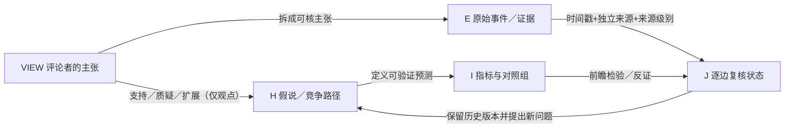

# TOPIC-011｜专家／UP主观点来源池（VIEW）

> 研究对象：2026-11-03—2029-01-20 美国政治—财政—企业—金融市场的候选机制。**VIEW 是评论者的陈述，不等于经独立验证的事实、因果效应或预测命中。** 本文件属于尚未合并的 PR #51 研究分支。

## 这套索引与现有研究的关系

`TOPIC-011 H01—H08 / Q01—Q10` 是**事前研究问题和竞争性假说**；`VIEW` 收集不同评论者相互支持/冲突的思路；`E` 收集可审计事件和原始资料；`I` 是同口径的时间序列与量化指标；`J` 是在指定时点对每一条机制边的暂时判定。不可把视频播放量、不同UP主重复同一新闻、同一UP主多次复述计为多份独立证据。

## 入库与审查流程

1. **来源卡**：唯一 `source_id`，评论者、作品标题、首次发布日期、首次观察日、定位ID/可公开访问URL、材料类型（原视频/机器转写/原文/二手摘要）、获取深度与转载限制。未找到视频页面时填 `URL=NA`，不得用推测链接。
2. **拆主张**：唯一 `view_claim_id`，分为事实声称、预测、法律解释、机制推断；原作者观点忠实转述（不复制未经授权的全文转写）；原主张中的时间、法律主体、量纲必须可追溯。
3. **绑定假说**：允许同一主张支持、质疑或扩展多个 H；如果尚无对应机制，挂到 Q09 候选，而不是自动改写 H01—H08 或确立因果。
4. **证据交叉**：每条有 `evidence_ids` 和原始资料 URL；若只是评论者陈述或单一媒体转引，状态为 `UNVERIFIED` / `PARTIAL`，不能标成官方事实。
5. **前瞻监测**：议员函→听证或传票→诉讼／行政行为→企业实际收入、融资、项目变化→风险溢价与股价，**分别记录发布日、实施日、财报期间、市场反应日**；保留反证和零结果。
6. **分层比较**：一个主张与官方资料不符时保留原始观点和纠偏记录；同源转载归为同一 `source_family`。历史判定追加时间快照，禁止覆盖旧预测。
7. **入正式知识**：VIEW 可以是 `NEEDS_EVIDENCE`；只有独立资料及复算满足要求，才申请升级 C-ID / H 或机制边。PR 未合并不得标记 `INTEGRATED`。

## 第一位已读取评论者

- [VIEW-S001｜大湾区老姚：马斯克、国会调查、赦免、CPI与现金流](2026-11-14-dayawanqu-laoyao.md)
- [逐主张可机读登记表](claim_register.csv) — `VIEW-S001-C01` 起，包含证据关联、反例与复核时间。
- [2026-11-14 研究会话审计](../sessions/2026-11-14-commentator-laoyao-musk-cpi.md)
- [观点池维护 Issue #54](https://github.com/fweiger/AI_book/issues/54) · [主研究问题 Issue #41](https://github.com/fweiger/AI_book/issues/41) · [研究草案 PR #51](https://github.com/fweiger/AI_book/pull/51)

## 复用及后续评论者

按 `VIEW-S002`、`VIEW-S003` 顺序登记**身份和原始出处**，每名评论者可有多条独立作品；区分“同一新闻的解说”和“独有预测”。可围绕政策制衡、特斯拉与政府资源、AI投资、利率、信贷／债务、外交/2028竞选这六类议题聚合，但不按政治立场评定评论者高低。定期生成“观点分歧—已发生事件—指标反应—未回答问题”复盘，仍需单独明确真实数据是否到手。