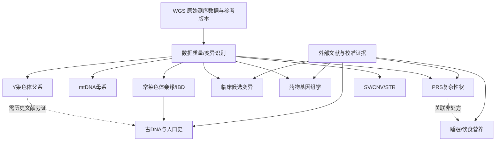

# TOPIC-017｜知识图谱（首轮研究结构，不是已证明的因果链）

- **支持/依赖**：数据质量是后续各研究分支的共同输入。
- **待验证**：古 DNA 的样本质量、抽样代表性、历史迁徙解释。
- **禁止直接推断**：共享父系标记 → 名人的已证实后裔；疾病变异候选 → 医学诊断；PRS → 必然发生的个体命运。
- 可机器读取的稳定节点与关系见 [knowledge-graph.json](knowledge-graph.json)。
